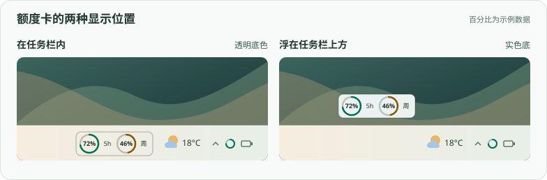

# Codex Taskbar Meter

在 Windows 11 任务栏查看 Codex 剩余额度。卡片随 ChatGPT 桌面端显示，优先放在天气旁边。

[下载 v1.0.0（Windows x64）](https://github.com/Esha-YS/codex-taskbar-meter/releases/download/v1.0.0/CodexTaskbarMeter-v1.0.0-win-x64.zip) · [发布页与校验值](https://github.com/Esha-YS/codex-taskbar-meter/releases/tag/v1.0.0)



## 安装

需要 **Windows 11 x64**，以及通过 Microsoft Store 安装并已登录的 **ChatGPT 桌面端**。

1. 下载上面的发布包，完整解压。
2. 双击 `Install.cmd`。
3. 打开 ChatGPT。额度卡会自动显示，无需另装 Node.js 或创建快捷方式。

若 PowerShell 提示下载的脚本被阻止，可先用 `Get-FileHash` 核对 ZIP 的 SHA-256。校验通过后，在 ZIP 的「属性」中选择「解除锁定」，再重新解压。

## 使用

- 卡片显示剩余百分比。可用的 5 小时和每周额度取决于账号，悬停可查看重置时间。
- ChatGPT 最小化时，卡片继续显示。完全退出 ChatGPT 后，卡片隐藏。天气旁空间不足时，卡片移到任务栏上方。
- 点击右下角的青绿色圆环可把卡片提到前面。若图标在 `^` 菜单里，可以在「设置 → 个性化 → 任务栏 → 其他系统托盘图标」中开启 **Codex 额度卡**。

## 卸载

双击发布包中的 `Uninstall.cmd`。这会移除额度卡和它的登录启动项。

如果已经删除发布包，可在 PowerShell 中运行下面的命令。

```powershell
powershell.exe -NoProfile -ExecutionPolicy RemoteSigned -File "$env:LOCALAPPDATA\CodexUsageTaskbar\manage.ps1" -Action uninstall
```

## 源码与许可

在 Windows 11 x64 上运行 `powershell.exe -NoProfile -ExecutionPolicy RemoteSigned -File .\manage.ps1 -Action build` 可构建发布包，输出位于 `dist/`。

程序通过本机 Codex CLI 读取额度，由独立的 Windows 进程绘制卡片。额度读取部分改编自 [Codex Usage Card v0.9.5](https://github.com/Lorie7813/codex-usage-card/releases/tag/v0.9.5-beta.1)。项目采用 [MIT 许可](LICENSE)，发布包附带 Node.js 运行时及其许可。
